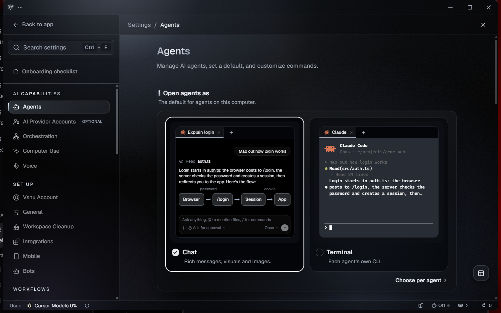

<h1 align="center">
   Vshu
</h1>

<p align="center">
  <a href="https://vshu.dev"></a>
  <a href="https://github.com/vishu6213/vshu/releases/latest"></a>
  
  
</p>

<p align="center">
  <strong>An IDE for running many AI coding agents in parallel.</strong><br/>
  Run Claude Code, Codex, OpenCode and other agents side by side, each in its own Git worktree,
  with a built-in terminal, browser, diff review and a true-black interface.<br/>
  <a href="https://vshu.dev">Website (vshu.dev)</a> · <a href="https://github.com/vishu6213/vshu/releases/latest">Download Latest Release</a>
</p>

---

## What is Vshu?

Vshu is a desktop IDE (Electron + TypeScript) built around parallel, agentic software
development. Instead of juggling branches in a single checkout, Vshu gives every task its own
isolated **Git worktree**, lets you run multiple AI coding agents side by side, and brings
chat, terminals, a built-in browser, and unified diff review together in a single window.

## Features

- **Parallel AI Agents.** Dispatch Claude Code, Codex, OpenCode, and other CLI agents across
  separate worktrees simultaneously, with live status tracking in the sidebar.
- **Worktree-First Git.** Create, switch, and clean up worktrees effortlessly; review agent
  changes as unified diffs, leave inline annotations, commit, or open pull requests.
- **Chat & Full Terminal.** Interact with agents in a structured chat view or drop directly
  into an interactive PTY terminal without losing context.
- **Built-in Browser.** Preview local web apps, inspect DOM elements, capture screenshots, and
  let agents interact with pages directly inside the IDE.
- **Remote Hosts & WSL.** Connect to SSH servers and WSL distributions seamlessly, working on
  remote repositories as if they were local.
- **Workspace Hooks (`vshu.yaml`).** Automate per-repository environment setup, bootstrap
  scripts, and teardown hooks when worktrees are created.
- **Plugins & Themes.** Extend Vshu with custom themes, language packs, and tools.
- **True-Black OLED UI.** A pure-black (`#000000`) high-contrast monochrome interface designed
  for long coding sessions.
- **One-Click In-App Updates.** New releases download and install directly from Settings (see
  [Updates](#updates)).

## Screenshots

<p align="center">
  
</p>
<p align="center">
  
</p>

## Download

Get the latest Windows installer, `Vshu-<version>-windows-setup.exe`, from [**vshu.dev**](https://vshu.dev) or [**GitHub Releases**](https://github.com/vishu6213/vshu/releases/latest).

The installer is per-user: it installs to `%LOCALAPPDATA%\Programs\vshu`, needs no
administrator rights, and adds Start menu and desktop shortcuts.

> **Windows SmartScreen.** Vshu builds are not code-signed yet, so the first time you run
> the installer Windows may show "Windows protected your PC". Click **More info**, then
> **Run anyway**. Updates installed from inside Vshu do not show this prompt.

## Updates

Vshu updates itself from this repository's GitHub Releases:

1. Vshu checks for a newer release when it starts and about once a day after that. You can
   also click **Check for updates** in **Settings > General** (or use the app menu).
2. It reads the newest release's `latest.yml` (the version, installer name and SHA-512).
   The repository is public, so no account or token is needed.
3. Vshu downloads the installer (only the changed blocks when it can, using the
   `.blockmap`), verifies its SHA-512, and offers **Restart to Update**.
4. The installer runs silently in the per-user install folder and relaunches Vshu.

Because the builds are unsigned, no publisher name is configured, so Vshu does not require
an Authenticode signature on updates; the SHA-512 in `latest.yml` still protects the download.
Draft releases are invisible to the updater until they are published. Maintainers: see
[RELEASING.md](RELEASING.md).

## Building from source (Windows)

Prerequisites:

- [Node.js](https://nodejs.org/) 24 and Git
- pnpm: `corepack enable pnpm` (the version is pinned by `packageManager`)
- Optional: Visual Studio 2022 Build Tools with "Desktop development with C++". Without it,
  `pnpm run ensure:electron-runtime` downloads prebuilt, checksum-pinned native addons
  instead of compiling them. Rust is not needed for the installer.

```bash
git clone https://github.com/vishu6213/vshu.git
cd vshu
pnpm install
pnpm dev                 # run in development mode
```

Build the installer:

```bash
pnpm run build:cli
pnpm run build:electron-vite
pnpm run ensure:electron-runtime
pnpm package:vshu        # dist/Vshu/Vshu.exe and Vshu_Installer/Vshu-<version>-windows-setup.exe
```

`pnpm package:vshu` uses `config/electron-builder.simple.cjs` and also writes `latest.yml`
and the installer `.blockmap` to `dist/`. `pnpm release:build` runs a clean full build from
scratch. `config/electron-builder.config.cjs` contains the full multi-platform release
configuration (signing, macOS, Linux).

## Useful Commands

| Command              | Description                                      |
| :------------------- | :----------------------------------------------- |
| `pnpm dev`           | Start Vshu in development mode                   |
| `pnpm typecheck`     | Run TypeScript typechecking across all targets   |
| `pnpm test`          | Run the test suite                               |
| `pnpm lint`          | Run linting and static checks                    |
| `pnpm format`        | Format files with `oxfmt`                        |
| `pnpm package:vshu`  | Build the Windows portable app & setup installer |
| `pnpm release:build` | Clean build and package release artifacts        |

## Vshu CLI

Vshu includes a built-in `vshu` CLI (`out/cli/index.js`) for automating workspaces, terminals,
agents, and the embedded browser from scripts or agent sessions:

- `vshu status` — inspect running workspaces, agents, and host status
- `vshu worktree` — create, list, and manage Git worktrees
- `vshu terminal` — open, read, and send input to IDE terminals
- `vshu browser` — open URLs, inspect pages, and capture screenshots

You can also launch Vshu on Windows using [launch-vshu.bat](launch-vshu.bat) or
[launch-vshu.vbs](launch-vshu.vbs) (silent launcher).

## Project Structure

- `src/main/` — Electron main process, worktree management, PTYs, and daemon/host services
- `src/renderer/` — React UI, editor/diff views, chat, terminal, and browser panes
- `src/cli/` — `vshu` CLI commands and runtime client
- `src/shared/` — Shared types, RPC contracts, and workspace configuration (`vshu.yaml`)
- `mobile/` — Companion mobile web shell
- `native/` — Native addons for PTY, security, and OS integration
- `resources/` — App icons, bundled themes, plugins, and skill assets

## License

Vshu is open-source software licensed under the [MIT License](LICENSE).
