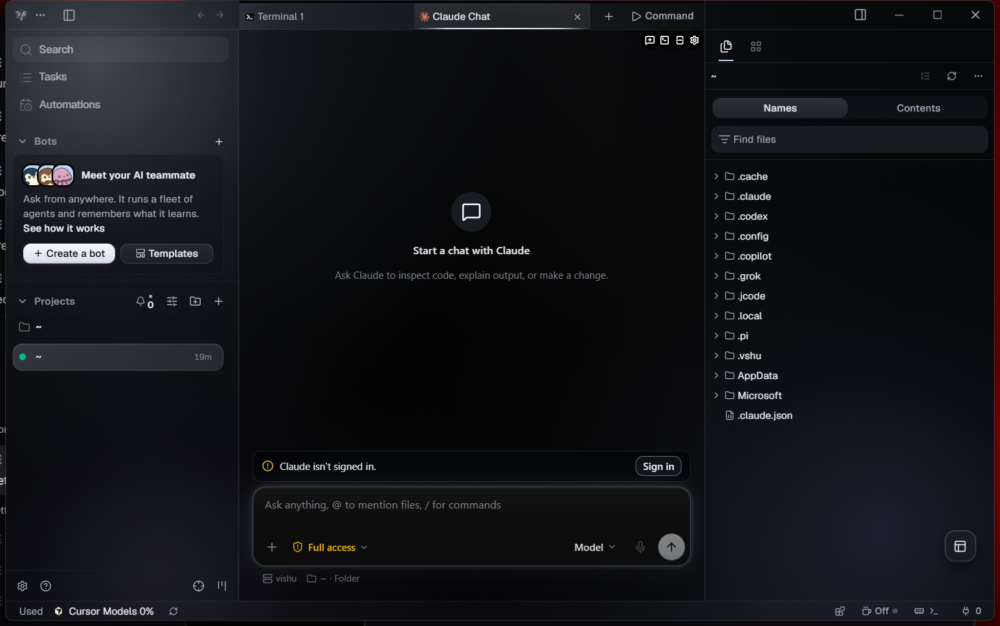

<h1 align="center">
   Vshu
</h1>

<p align="center">
  <a href="https://github.com/vishu6213/vshu/releases/latest"></a>
  <a href="https://github.com/vishu6213/vshu/actions/workflows/ci.yml"></a>
  
  
</p>

<p align="center">
  <strong>An IDE for running many AI coding agents in parallel.</strong><br/>
  Run Claude Code, Codex, OpenCode and other agents side by side, each in its own Git worktree,
  with a built-in terminal, browser, diff review and a true-black interface.
</p>

---

## What is Vshu?

Vshu is a desktop IDE (Electron + TypeScript) built around agentic development: you give each
task its own worktree, start an agent in it, and review, test and merge the results from one
window. It is a rebranded and customized distribution of an MIT-licensed upstream project (see
[Attribution](#attribution)), kept in sync with it so new upstream features and fixes keep
arriving.

## Features

- **Parallel agents.** Dispatch Claude Code, Codex, OpenCode and other CLI agents across
  separate worktrees at the same time, and watch their status from one sidebar.
- **Worktree-first Git.** Create, switch and clean up worktrees; review agent changes as
  unified diffs, annotate them, and commit or open pull requests.
- **Chat or terminal.** Talk to an agent in a chat view or drop into its full terminal without
  losing context.
- **Built-in browser.** Preview web apps, inspect elements and let agents drive the page.
- **Remote and WSL.** Work on SSH hosts and WSL distributions as if they were local.
- **Plugins and themes.** Extend Vshu with themes, language packs and agent tools.
- **True-black UI.** A pure black (`#000000`) monochrome theme that is easy on OLED screens.
- **In-app updates.** New releases install from Settings with one click (see
  [Updates](#updates)).

## Screenshots

<p align="center">
  
</p>
<p align="center">
  
</p>

## Download

Get the latest Windows installer, `Vshu-<version>-windows-setup.exe`, from
[**GitHub Releases**](https://github.com/vishu6213/vshu/releases/latest).

The installer is per-user: it installs to `%LOCALAPPDATA%\Programs\vshu`, needs no
administrator rights, and adds Start menu and desktop shortcuts.

> **Windows SmartScreen.** Vshu builds are not code-signed yet, so the first time you run
> the installer Windows may show "Windows protected your PC". Click **More info**, then
> **Run anyway**. Updates installed from inside Vshu do not show this prompt.

## Updates

Vshu updates itself from this repository's GitHub Releases:

1. Vshu checks for a newer release when it starts and about once a day after that. You can
   also click **Check for updates** in **Settings > General** (or use the app menu).
2. It reads the newest release's `latest.yml` (the version, installer name and SHA-512).
   The repository is public, so no account or token is needed.
3. Vshu downloads the installer (only the changed blocks when it can, using the
   `.blockmap`), verifies its SHA-512, and offers **Restart to Update**.
4. The installer runs silently in the per-user install folder and relaunches Vshu.

Because the builds are unsigned, no publisher name is configured, so Vshu does not require
an Authenticode signature on updates; the SHA-512 in `latest.yml` still protects the download.
Draft releases are invisible to the updater until they are published. Maintainers: see
[RELEASING.md](RELEASING.md).

## Building from source (Windows)

Prerequisites:

- [Node.js](https://nodejs.org/) 24 and Git
- pnpm: `corepack enable pnpm` (the version is pinned by `packageManager`)
- Optional: Visual Studio 2022 Build Tools with "Desktop development with C++". Without it,
  `pnpm run ensure:electron-runtime` downloads prebuilt, checksum-pinned native addons
  instead of compiling them. Rust is not needed for the installer.

```bash
git clone https://github.com/vishu6213/vshu.git
cd vshu
pnpm install
pnpm dev                 # run in development mode
```

Build the installer:

```bash
pnpm run build:cli
pnpm run build:electron-vite
pnpm run ensure:electron-runtime
pnpm package:vshu        # dist/Vshu/Vshu.exe and Vshu_Installer/Vshu-<version>-windows-setup.exe
```

`pnpm package:vshu` uses `config/electron-builder.simple.cjs` and also writes `latest.yml`
and the installer `.blockmap` to `dist/`. `pnpm release:build` runs all of the above from a
clean output folder. `config/electron-builder.config.cjs` is the full upstream release
configuration (signing, macOS, Linux) and needs extra native tools.

Useful checks: `pnpm run typecheck`, `pnpm exec oxlint`, `pnpm rebrand:check`.

## Staying in sync with upstream

<!-- vshu-rebrand:off -->

Vshu tracks its upstream, [Orca](https://github.com/stablyai/orca) (MIT), and pulls in its
changes with `scripts/sync-upstream.mjs`, which rebrands every upstream snapshot with the
codemod before merging it. New Orca features and fixes arrive without touching Vshu's branding.
<!-- vshu-rebrand:on -->

```bash
pnpm sync:upstream --dry-run   # build the rebranded snapshot and report what would change
pnpm sync:upstream             # update the snapshot branch and print the merge steps
pnpm sync:upstream --merge     # ...and merge it into the current branch
```

On Windows, `update-vshu.bat` does the whole thing in one click: sync with `--merge`, then
`pnpm install`, the rebrand check, the build and the installer.

What a sync does:

1. Adds or fetches the `upstream` remote (main branch only, never upstream's tags).
2. Checks out `upstream/main` in a temporary worktree, runs the rebrand codemod on it, and
   keeps Vshu's `version`, `description`, `author` and `homepage` in `package.json`.
3. Commits that snapshot onto the local `upstream-vshu` branch (one linear commit per sync).
4. Merges `upstream-vshu` with a normal `git merge`, so upstream changes are never dropped
   silently, then:
   - **keeps your branding**: the logo, app and tray icons, brand assets
     (`resources/branding/`, `resources/app-icons/`, `resources/tray/`, `resources/build/icon.*`,
     `mobile/assets/`), `README.md`, `RELEASING.md` and `LICENSE` always keep Vshu's copy.
     The same paths are marked `merge=ours` in `.gitattributes`, and the script registers that
     merge driver (`git config merge.ours.driver true`), so plain `git merge` keeps them too;
   - drops upstream's CI workflows and `CODEOWNERS`, which only work in the upstream repo;
   - commits the merge, regenerates the brand assets with `scripts/apply-vshu-branding.mjs`
     and runs `pnpm rebrand:check`.
5. Any other conflict (for example a file you customized that upstream also changed) is left
   for you: resolve it, `git commit`, run `node scripts/apply-vshu-branding.mjs`, and run the
   sync (or `update-vshu.bat`) again.

The script refuses to run with uncommitted changes.

**First sync.** Vshu's history starts at a squashed fork commit, so it shares no commits with
upstream. Pass the upstream commit it was forked from once:

```bash
pnpm sync:upstream --fork-point d3a843d032 --merge
```

That commit's rebranded snapshot becomes the root of `upstream-vshu`. Before the first merge
it is recorded on your branch with `git merge -s ours --allow-unrelated-histories` (no file
changes), so the normal merge then applies every upstream change made after it. Later syncs
need no flag.

### Rebrand codemod

`scripts/vshu-rebrand.mjs` is a deterministic, idempotent codemod that rewrites every tracked
file and path to the Vshu brand (product name, CLI, packages, env vars, app ids, the
`github.com/vishu6213/vshu` repository). Run `node scripts/vshu-rebrand.mjs` to apply it and
`pnpm rebrand:check` to verify nothing is left (exit 1 lists the stragglers). `LICENSE`, the
sync and codemod scripts, and text between `vshu-rebrand:off`/`on` comments are excluded.
Brand images are generated by `scripts/apply-vshu-branding.mjs` from
`resources/branding/vshu-logo-source.png`.

## Attribution

<!-- vshu-rebrand:off -->

Vshu is based on [Orca](https://github.com/stablyai/orca) (MIT) by Lovecast Inc. Thank you to
the Orca authors and contributors.
<!-- vshu-rebrand:on -->

## License

Vshu is open-source software licensed under the [MIT License](LICENSE), which keeps the
original Lovecast Inc. copyright notice alongside the Vshu Contributors one.
